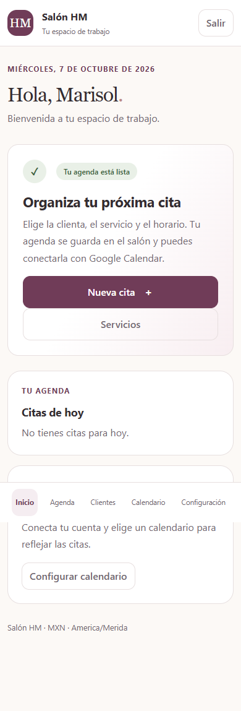

# Entrega: acceso de Marisol, citas y preparación de Google Calendar

7 de octubre de 2026. Aplicación local en http://127.0.0.1:8010/.

## Cambios listos

- La misma cuenta administradora ahora tiene usuario y nombre Marisol; su contraseña
  fue cambiada a la solicitada. Conserva su identificador y operaciones anteriores.
- Inicio con el botón Nueva cita, servicios y citas reales del día.
- Clientas: crear, editar, buscar por nombre/fragmento/teléfono. Los nombres se pueden
  repetir; el selector muestra teléfono e ID para distinguir incluso homónimas.
- Servicios: nombre, descripción, duración, precio base y activo/inactivo.
- Citas: clienta, servicio libre o varios del catálogo, inicio/fin, notas privadas y
  estados pendiente/confirmada/completada/cancelada/no asistió.
- Agenda de día, semana y próximas citas.
- Traslapes locales: advertencia, aceptación de un caso especial vinculada al contenido
  exacto y a la sesión. Revisar otra versión exige aceptar nuevamente.
- Clave idempotente para prevenir citas duplicadas por doble clic/reintentos.
- Servicios previstos guardan nombre y duración del momento; editar el catálogo no
  altera esos datos de la cita existente.
- Google: OAuth con state y PKCE, selección de calendario propio, tokens cifrados,
  disponibilidad, publicación/cancelación, cola PostgreSQL, reintentos y etag.
- Cambios externos se revisan antes de reemplazarlos; no se sobrescriben silenciosamente.
- Auditoría de operaciones sin contraseñas, tokens ni notas privadas innecesarias.

## Cómo usarlo

Entra con Marisol y la contraseña solicitada. Desde Inicio pulsa Nueva cita. Si la
clienta no existe, usa Crear una clienta, guarda su nombre y vuelve a la cita.
Escribe el servicio previsto, indica inicio/fin y guarda. Los servicios del catálogo
son opcionales para comenzar; puedes crearlos desde Inicio → Servicios.

Para cambiar o cancelar una cita, ábrela desde Agenda y pulsa Editar cita.
Cancelar o completar no crea atenciones, consumos ni pagos.

En Calendario encontrarás los pasos para crear el proyecto Google Cloud y las
credenciales OAuth. [Guía completa](google-calendar.md). Los campos están en `.env`;
la clave de cifrado ya se generó y no debe cambiarse al reiniciar.

## Verificación

- Migraciones aplicadas en salon_hm; no hay migraciones pendientes.
- 43 pruebas aprobadas sobre una base PostgreSQL de pruebas separada.
- Chrome: acceso de Marisol, inicio, nueva cita, nueva clienta, día/semana/próximas,
  clientes, servicio nuevo y configuración de Google.
- Revisión móvil a 390 px y de escritorio; sin errores de JavaScript o HTTP en el flujo.
- Los flujos de alta, edición, traslapes e idempotencia se probaron mediante el backend
  con PostgreSQL; no se añadieron clientas ni citas ficticias a la base real.
- Autorización, fallos de Google, respuestas perdidas, revocación, cancelación y cambios
  externos se probaron con dobles de Google. El generador de URL OAuth/PKCE y los
  objetos de credenciales/transporte del SDK se comprobaron sin llamadas externas.

## Pendiente

No hay credenciales OAuth todavía. Falta la autorización real de Marisol y comprobar
una cita de prueba en su calendario. Google Calendar no está conectado actualmente.
Productos, atenciones, fórmulas, cobros, anticipos, archivo de clientas, importación
de historial y asistente siguen en etapas posteriores. Docker y Railway no se han
ejecutado. Esto amplía la base local; no equivale todavía al MVP completo.

