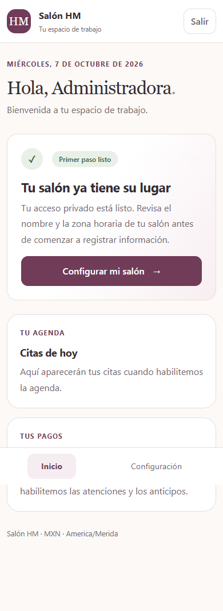

# Etapa 1: base local

Entregada el 7 de octubre de 2026. Implementación local; no se ha desplegado.

Actualización: el inicio ahora usa la base existente `salon_hm`, con usuario,
contraseña, host y puerto configurados en `.env`. La instancia aislada usada para
las pruebas iniciales se conserva separada; no se inicia desde el script.

## Listo

- Django 5.2.18 y Python 3.13, dependencias fijadas con hashes.
- Usuario propio desde la primera migración, acceso privado y salida con CSRF.
- Pantallas de acceso, inicio y configuración para celular y escritorio.
- Configuración única: nombre, MXN y zona horaria válida, inicialmente America/Merida.
- Cambios de configuración con validación de permisos y auditoría transaccional.
- Bootstrap 5.3.8 y HTMX 2.0.8 servidos localmente.
- Dockerfile/Compose para desarrollo con PostgreSQL 17 y variables de entorno.
- Entorno local preparado en esta PC usando una instancia aislada de PostgreSQL 16.
- README y comando de inicio que solicita crear la administradora sin claves predeterminadas.

## Validación realizada

- Migraciones aplicadas en PostgreSQL real, separado de las bases existentes.
- `manage.py check`: sin problemas.
- `manage.py makemigrations --check --dry-run`: sin cambios pendientes.
- `manage.py test`: 17 pruebas aprobadas sobre PostgreSQL real.
- Chrome con Playwright: acceso obligatorio, login, inicio, configuración y logout.
- Revisión a 390 × 844 y 1280 × 900; sin desbordamiento horizontal en el inicio móvil.
- Sin errores JavaScript ni respuestas HTTP de error en el flujo del navegador.
- Script de inicio probado reiniciando PostgreSQL y con una cuenta temporal existente.
- Cuenta temporal de navegador retirada al finalizar. No se entrega una contraseña demo.

Las pruebas cubren credenciales inválidas, cuenta inactiva, redirección externa,
rutas privadas, CSRF, permisos, validación de zona, fecha local, configuración única,
rollback al fallar la auditoría y health check ante falla de conexión.

## Cómo probar

Desde PowerShell en la carpeta del proyecto:

```powershell
powershell -NoProfile -ExecutionPolicy Bypass -File .\scripts\iniciar-local.ps1
```

La primera vez solicita crear tu cuenta. Abre http://127.0.0.1:8010, entra,
revisa Configuración y cierra sesión. El puerto 8010 evita el servicio existente
en 8000. Detén Django con Ctrl+C. [Instrucciones completas](../README.md).

## Pendiente

- Validar el build y arranque Docker: Docker no está instalado en esta PC.
- Clientes y catálogos (etapa 2), luego atenciones y pagos (etapa 3).
- Agenda y anticipos (etapa 4). El anticipo mantendrá su fecha de ingreso al aplicarlo.
- Importar el historial cuando se comparta y se revise su formato.
- Google Calendar, asistente y despliegue: todavía no implementados ni validados.


